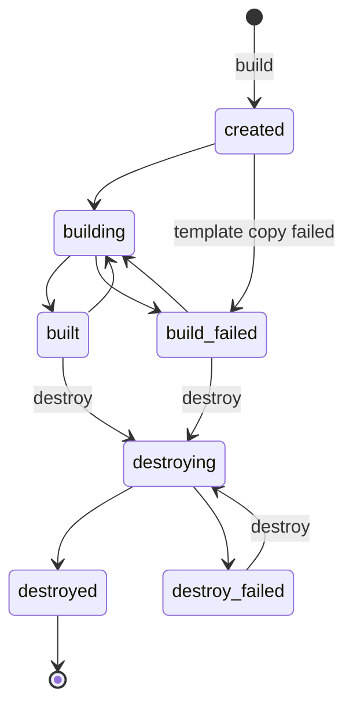

# Splunk Attack Range v6


The Splunk Attack Range builds instrumented lab environments for detection development and testing. A range is described in a few provider-neutral YAML documents and realized on AWS, Azure, or VMware vSphere with Terraform.

> **Status:** v6 is a rewrite. The CLI can `plan`, `build`, `list`, and `destroy` the infrastructure of ranges. Provisioning the servers (Ansible roles and Python steps), attack simulation, the web app (`app/`), the REST API (`api/`), and the Docker setup (`docker/`) are not ported to the new code yet.

---

## Getting started

**Prerequisites**

- [uv](https://docs.astral.sh/uv/getting-started/installation/)
- [Terraform](https://developer.hashicorp.com/terraform/install) 1.10 or newer, installed separately (`uv sync` does not install it). `plan`, `build`, and `destroy` run it from your `PATH`, or from the path given with `--terraform`. Version 1.10 is the first that can lock S3 state without DynamoDB. On macOS: `brew tap hashicorp/tap && brew install hashicorp/tap/terraform`
- Credentials for your provider in the usual places: `~/.aws` or `AWS_*` for AWS, `az login` or `ARM_*` for Azure (with `ARM_SUBSCRIPTION_ID` set), `VSPHERE_SERVER`, `VSPHERE_USER`, and `VSPHERE_PASSWORD` for VMware

**Install**

```bash
git clone <repo-url>
cd attack_range
uv sync
```

**Run**

```bash
uv run attack-range plan tmp/ar_template      # show what would be created; registers nothing
uv run attack-range build tmp/ar_template     # register a new range, create it, and print its id
uv run attack-range list                      # show the ranges and their state
uv run attack-range destroy <RANGE_ID>        # remove a range again (asks for confirmation)
```

`plan` and `build` take a template: a directory of range documents, or a single `.yaml` file that holds all documents separated by `---`. [`tmp/ar_template`](tmp/ar_template) is a Splunk server and a Windows server on AWS. Every `build` registers a new range under a fresh UUID, even from the same template, so one template can run several times. After `build`, the CLI prints the id and the private and public IP address of every server. `destroy` takes that id.

| Option | Command | Meaning |
|--------|---------|---------|
| `--provider aws\|azure\|vmware` | `plan`, `build` | Which bindings to use. Needed only when the template binds the network to more than one provider, like [`tmp`](tmp). |
| `--local-state` | `build` | Keep the Terraform state in the range folder instead of S3 or Azure Blob Storage. `destroy` uses the same choice. |
| `--terraform BIN` | `plan`, `build`, `destroy` | Terraform binary to run. Default: `terraform`. |
| `-y`, `--yes` | `destroy` | Skip the confirmation. Required when not running in a terminal. |
| `--all` | `list` | Include destroyed ranges. |

---

## The home folder and range states

The first run creates `~/.attack_range` (set `ATTACK_RANGE_HOME` to use another folder):

```text
~/.attack_range/
├── plans/
│   └── <name>-<provider>/      # Terraform code of `plan`, with local state
└── ranges/
    └── <range id>/
        ├── range.yaml          # name, provider, location, template path, state, outputs, history
        ├── documents/          # copy of the template's .yaml files and the user-data files they use
        └── terraform/          # generated Terraform code
```

`build` copies the template into `documents/`, so later edits to the template don't change a running range. `destroy` reads the copy.

Each range moves through these states, and `range.yaml` records every change with its time and error:



A failed or interrupted build ends in `build_failed` and can still be destroyed. A failed destroy can be run again. After a successful destroy, the record and documents stay, and only `terraform/` is deleted. `list` hides destroyed ranges unless you pass `--all`.

---

## Describing a range

A template holds four kinds of documents (API version `v0.1`), either in the `*.yaml` and `*.yml` files of a directory or in one file:

| Kind | Describes |
|------|-----------|
| `Network` | Address space, zones (`internet`, `private`, `isolated`), segments, internet and NAT gateways, reachability, the perimeter, and filters (allow-lists of flows). Provider neutral. |
| `NetworkBinding` | How one provider realizes the network, for example a VPC with subnets and security groups on AWS. |
| `Server` | One guest: login, interfaces with their segment and address, optional bootstrap file, and provisioning steps. Provider neutral. |
| `ServerBinding` | How one provider realizes the server, for example instance type, AMI, and root volume on AWS. |

Bootstrap files named by `bootstrap.userData` are read from `user-data/` in the template directory (or next to the template file). One directory can hold bindings for several providers next to each other. Each command uses the bindings of one provider.

Example network ([`tmp/ar_template/ar.network.yaml`](tmp/ar_template/ar.network.yaml), shortened):

```yaml
apiVersion: v0.1
kind: Network
metadata:
  name: ar
spec:
  addressSpace:
    cidr: 10.0.0.0/16
  zones:
    - name: edge
      exposure: internet
    - name: private
      exposure: private
  segments:
    - name: public
      zone: edge
      cidr: 10.0.1.0/24
    - name: mgmt
      zone: private
      cidr: 10.0.2.0/24
  gateways:
    - name: internet
      type: internet
      attach: public
    - name: egress
      type: nat
      attach: public
      serves: [mgmt]
  reachability:
    - from: mgmt
      to: internet
      via: egress
```

**Tags.** A NetworkBinding can set tags for every resource of the range, for example to meet a tagging policy of the account:

```yaml
kind: NetworkBinding
spec:
  network: ar
  provider: aws
  location: eu-central-1        # becomes the provider region
  tags:
    splunkit_environment_type: non-prd
    splunkit_data_classification: private
```

| Provider | How the tags are applied |
|----------|--------------------------|
| AWS | `default_tags` of the `aws` provider, so every taggable resource gets them |
| Azure | Merged into the `tags` of every taggable resource (resource group, virtual network, public IPs, NAT gateways, NSGs, NICs, VMs) |
| VMware | Not supported in v0.1; a VMware binding with tags is rejected |

Keys are 1 to 128 characters and values at most 256. Keys must not start with `aws:` or `azure`, must not contain `< > % & \ ? /`, and must not be `Name` or `attack-range`, which Attack Range sets itself.

The documents are validated before anything runs: every reference must exist, addresses must lie inside their segment, every server needs a binding for the chosen provider, and all bindings must use the same location.

---

## Terraform state

| Provider | State is stored in |
|----------|--------------------|
| AWS | S3 bucket `attack-range-tfstate-<account id>-<region>`: versioned, encrypted, public access blocked, locked with S3 lock files |
| Azure | Storage account `artfstate<hash>` in resource group `attack-range-tfstate`, container `tfstate`, locked with blob leases |
| VMware | `terraform.tfstate` in `ranges/<range id>/terraform/` |

The bucket or storage account is shared by all ranges in an account (or subscription) and region. It is created on first use and is never deleted, including by `destroy`. Each range gets its own key, `<prefix>/<range id>/terraform.tfstate`, so ranges built from the same template never share state. Existing local state is copied into the remote store on the next run. `plan` always uses local state in `plans/` and does not touch the remote store.

| Variable | Overrides |
|----------|-----------|
| `ATTACK_RANGE_STATE_PREFIX` | Key prefix (default `attack-range`) |
| `ATTACK_RANGE_STATE_BUCKET` | S3 bucket name |
| `ATTACK_RANGE_STATE_RESOURCE_GROUP` | Azure resource group |
| `ATTACK_RANGE_STATE_STORAGE_ACCOUNT` | Azure storage account |

---

## Code layout

The code follows a clean architecture. Use cases depend only on abstract ports, and the CLI wires the concrete implementations together with [dependency-injector](https://python-dependency-injector.ets-labs.org/).

| Package | Contents |
|---------|----------|
| [`attack_range/domain`](attack_range/domain) | Pydantic models of the four document kinds, `RangeRecord`, and the `RangeState` state machine |
| [`attack_range/application`](attack_range/application) | `CyberRange` and its consistency checks, and the ports `CyberRangeRepository`, `RangeStore`, `RangeDocuments`, `Provisioner`, and `ProvisionLog` |
| [`attack_range/use_cases`](attack_range/use_cases) | `Plan`, `Build`, `Destroy`, and `ListRanges`, with their input and output DTOs and output boundaries |
| [`attack_range_infrastructure`](attack_range_infrastructure) | The home folder, `FileCyberRangeRepository` (reads templates), `YamlRangeStore` and `FileRangeDocuments` (keep ranges in the home folder), and `TerraformProvisioner` with one renderer per provider and the state backends |
| [`cli`](cli) | Argument parsing, the dependency-injection container, and the console presenters |
| [`tests`](tests) | Unit tests, plus `terraform validate` of the generated code |

A new provisioner, for example one that generates Bicep, implements `Provisioner` (`render`, `plan`, `apply`, `destroy`, `clean`) and is registered in [`cli/container.py`](cli/container.py). The same goes for keeping range records in a database instead of YAML files: implement `RangeStore` (`create`, `get`, `update`, `list`) and swap it in the container.

**Run the tests**

```bash
uv run pytest
```

The tests use a temporary home folder and never touch `~/.attack_range`. The `terraform validate` tests download the Terraform providers and are skipped when Terraform is not installed.

---

## Support
Please use the [GitHub issue tracker](https://github.com/splunk/attack_range/issues) to submit bugs or request features.

If you have questions or need support, you can:

* Join the [#security-research](https://splunk-usergroups.slack.com/archives/C1S5BEF38) room in the [Splunk Slack channel](http://splunk-usergroups.slack.com)
* Post a question to [Splunk Answers](http://answers.splunk.com)
* If you are a Splunk Enterprise customer with a valid support entitlement contract and have a Splunk-related question, you can also open a support case on the https://www.splunk.com/ support portal

---

## Contributing
We welcome feedback and contributions from the community! Please see our [contribution guidelines](docs/CONTRIBUTING.md) for more information on how to get involved.

---

## Author
* [Jose Hernandez](https://twitter.com/_josehelps)
* [Patrick Bareiß](https://twitter.com/bareiss_patrick)

## Contributors
* [Bhavin Patel](https://twitter.com/hackpsy)
* [Rod Soto](https://twitter.com/rodsoto)
* Russ Nolen
* Phil Royer
* [Joseph Zadeh](https://twitter.com/JosephZadeh)
* Rico Valdez
* [Dimitris Lambrou](https://twitter.com/etz69)
* [Dave Herrald](https://twitter.com/daveherrald)
* Ignacio Bermudez Corrales
* Peter Gael
* Josef Kuepker
* Shannon Davis
* [Mauricio Velazco](https://twitter.com/mvelazco)
* [Teoderick Contreras](https://twitter.com/tccontre18)
* [Lou Stella](https://twitter.com/ljstella)
* [Christian Cloutier](https://github.com/ccl0utier)
* Eric McGinnis
* [Micheal Haag](https://twitter.com/M_haggis)
* Gowthamaraj Rajendran
* [Christopher Caldwell](https://github.com/cudgel)
* [Zachary Christensen](https://github.com/ZachTheSplunker)
* [JerinSaji0](https://github.com/JerinSaji0)
* [Michal Cichorz](https://github.com/cichyx96)
